# markloc 算法步骤与示意图

> 本文描述**当前代码实际实现的算法**，每一步都标注了对应的源文件和函数。
> 判定阈值：`kNgThreshold = 1.0`。
>
> ⚠️ 文中标注 `[未激活]` 的部分是已实现但当前 `params.txt` 里未启用的功能，
> 需要重新建模才会生效。

---

## 〇、整体结构

算法分**两个阶段**：

```
建模阶段（建一次）            检测阶段（每张图跑一次）
─────────────────           ─────────────────────
收集 OK 样本                  读入模型
  ↓                            ↓
统计每个像素的笔画频率         四个区域并行检测
  ↓                            ↓
切分单字符                     五个分支各自打分
  ↓                            ↓
固化容差掩膜 + 字符框          取最大值，与 1.0 比较
  ↓
写入 models/char/vNN/
```

---

## 一、建模阶段

### 步骤 1：收集并按视角分组

**代码**：`TrainWindow::collectByView`

```
扫描目录 → 解析文件名末尾 _00.._05 → 按视角分到 6 个桶
```

命名约定 `{料号}_{FT|RT}_..._{NN}.tif`，末尾两位决定它属于哪个视角。

### 步骤 2：自动判定极性

**代码**：`buildModel`（`char_core.cpp`）

不同打光下，刻印可能比背景**亮**也可能比背景**暗**。

```
取 line1 区域 → 去背景得到残差 → 比较正负两端的极值
  负向更强 → invert = 1（暗刻印，需要翻转）
  正向更强 → invert = 0（亮刻印）
```

### 步骤 3：统计笔画频率图

**代码**：`buildModel` → `strokeSignal` + 累加

这一步是全算法的地基。

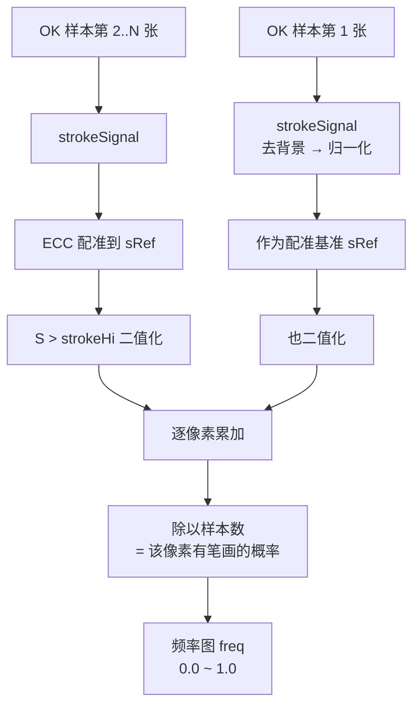

**频率图的含义**：某个像素在多少比例的 OK 样本里"有笔画"。

- 字符主体核心处 ≈ 1.0（几乎每次都有墨）
- 字符边缘 ≈ 0.3~0.6（有时因对位误差偏一点）
- 空白背景 ≈ 0.0

### 步骤 4：生成容差掩膜

**代码**：`buildModel`

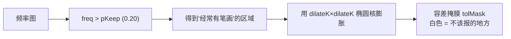

**为什么要膨胀**：频率图只覆盖"平均位置"，但实际对位会有几个像素位移。
膨胀一圈后，掩膜能容忍这点抖动，避免边缘频繁误报。

### 步骤 5：切分单字符 `[未激活]`

**代码**：`charsplit::splitChars`（`char_split.cpp`）

只对**固定内容区**（logo / line1 / line2）执行。code 区不切。

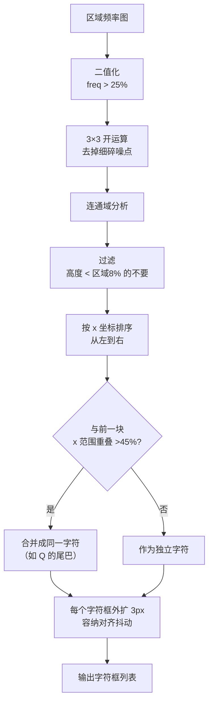

实测切分效果（v00 的 line1）：

```
原图：  Q 0 4 6 R 8 N L P
切出：  9 个字符框，位置准确
```

### 步骤 6：统计粗细基线 `[已关闭]`

code 区（code）本版本**整体关闭**，因为每颗产品内容不同，无法建立可靠模板。

### 步骤 7：写入模型目录

```
models/char/vNN/
├── logo _ref.png    配准基准
├── logo _freq.png   频率图
├── logo _tol.png    容差掩膜
├── chars_0.txt      字符框列表（logo 区）   [未激活]
├── chars_1.txt      字符框列表（line1 区）  [未激活]
├── chars_2.txt      字符框列表（line2 区）  [未激活]
├── line1_ref/freq/tol.png
├── line2_ref/freq/tol.png
├── code _ref/freq/tol.png
├── code_stats.txt
└── params.txt
```

---

## 二、检测阶段

### 总流程

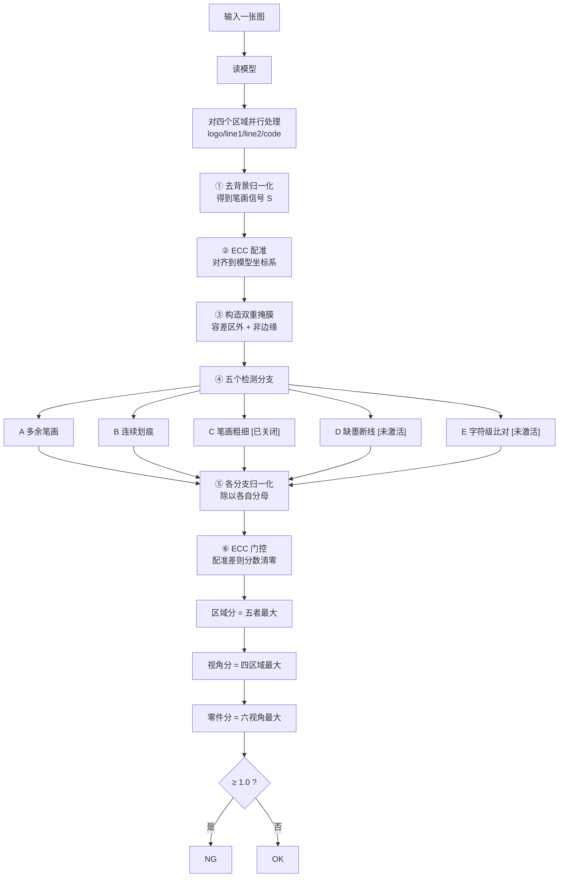

### 步骤 ①：去背景 + 归一化

**代码**：`strokeSignal`（`char_core.cpp`）


**为什么这样做**：整张图有明暗渐变，直接找"亮"会把大片区域都选中。
减去模糊版本后，只留下比周围突出的细笔画。除以 94 分位让不同曝光的视角落在同一刻度。

### 步骤 ②：ECC 配准

**代码**：`detail::estimateWarp`（`warp.cpp`）

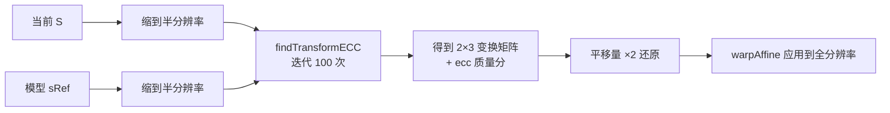

半分辨率估计把速度提升约 4 倍，结果乘 2 还原即可。

### 步骤 ③：双重掩膜

**代码**：`analyze`（`char_core.cpp`）

```
usable  = 四边各屏蔽 edgeTB / edgeLR 像素     （边缘干扰大）
allowed = NOT tolMask                        （容差区内不该报）
```

只有**同时满足两者**的像素才可能被判定为缺陷。

### 步骤 ④a：分支 A — 多余笔画

**代码**：`det::scoreAppendage`

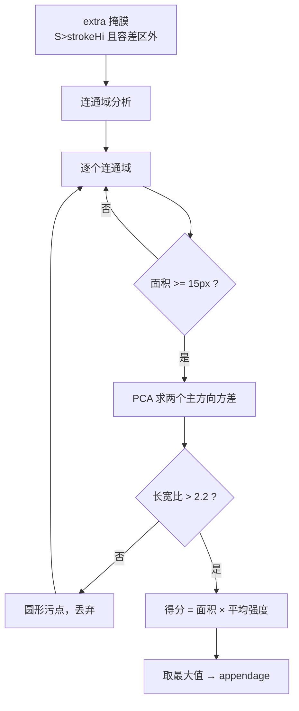

只在 **logo 区**执行。

### 步骤 ④b：分支 B — 连续划痕

**代码**：`det::scoreScratch`

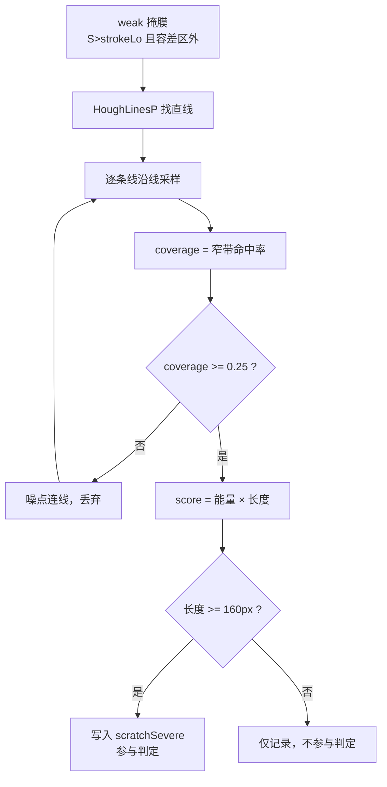

**核心洞察**：实测严重缺陷"长而淡"（225px），轻微瑕疵"短而亮"（≤121px）。
用**长度**而非强度做门槛。

### 步骤 ④c：分支 C — 笔画粗细 `[已关闭]`

**代码**：`det::scoreCode`

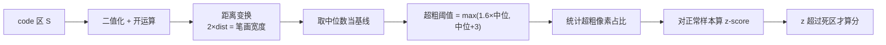

本版本已整体关闭此分支。

### 步骤 ④d：分支 D — 缺墨断线 `[未激活]`

**代码**：`det::scoreMissing`（`detect_missing.cpp`）

这是**方向相反**的检测：找"本该有墨却缺失"。

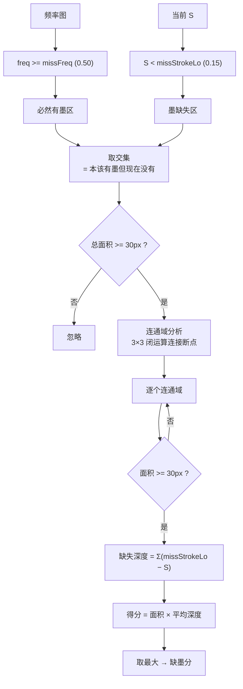

**为什么用 0.50 这么高的频率门槛**：0.50 意味着"这个像素在一半以上的 OK 样本里都有墨"。
这样只有字符主体的核心部位才算"必然有墨"，边缘波动不算，避免误报。

### 步骤 ④e：分支 E — 字符级比对 `[未激活]`

**代码**：`charsplit::matchChars`（`char_split.cpp`）

对每个切好的字符框单独比对。

```mermaid
flowchart TD
    A["字符框列表<br/>来自建模"] --> B["逐个字符框"
    B --> C["裁出该字符的<br/>频率图 + 当前 S"]
    C --> D["缺墨判定<br/>freq高 ∧ S低"]
    C --> E["多余判定<br/>S高 ∧ freq低"]
    D --> F["缺失比例 = 缺墨像素/笔画像素"]
    E --> G["多余像素数"]
    F --> H{"缺失比例 > 15% ?"}
    G --> I{"多余像素 > 30 ?"}
    H -->|是| J["该字符异常"]
    I -->|是| J
    H -->|否| K
    I -->|否| K["该字符正常"]
    J --> L["记录字符序号"]
    L --> B
    K --> B
    B --> M["取最严重的字符得分"]
```

**价值**：能定位到"**第 3 个字符漏印**"，而不是只报"型号行有问题"。

### 步骤 ⑤：归一化

各分支原始量量纲不同，必须归一化才能比较：

| 分支 | 原始量 | 归一化 |
|---|---|---|
| A 多余笔画 | 面积 × 平均强度 | ÷ `appendageT` |
| B 连续划痕 | 能量 × 长度 | ÷ `scratchT` |
| C 笔画粗细 | z-score | (z − 死区) ÷ 1.5 |
| D 缺墨 | 面积 × 深度 | ÷ `missT` |
| E 字符级 | 缺失比例 | (比例 − 门槛) ÷ `charT` |

`scratchT` 各视角独立标定，实测差异可达数倍。

### 步骤 ⑥：ECC 门控

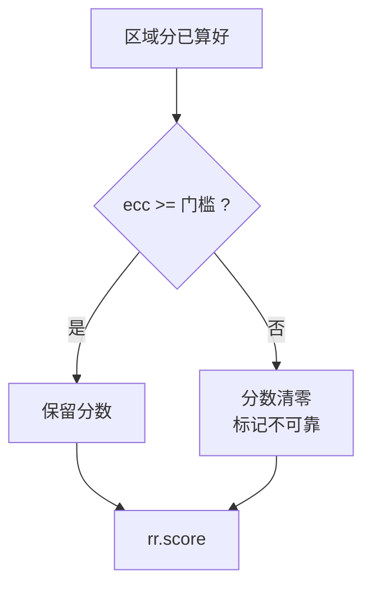

门槛：字符区 `eccMin=0.60`，code 区 `codeEccMin=0.55`。

**意义**：配准失败时所有差异都是错位造成的伪差，不能当真。

---

## 三、判定聚合

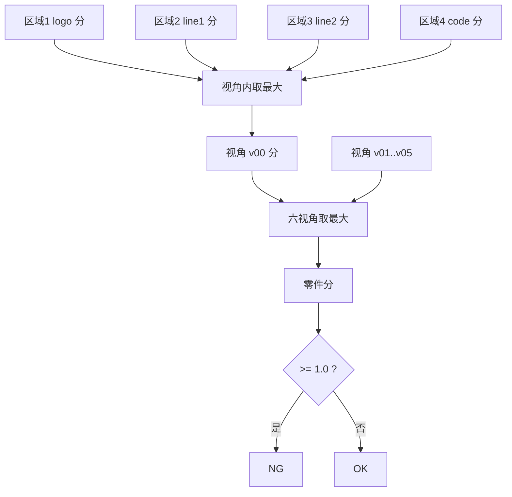

**三层 max 的含义**：任何一处超标，整颗零件就是 NG。没有投票，没有平均。

---

## 四、示意图：一次检测的数据形态

以 logo 区（700×235）为例：

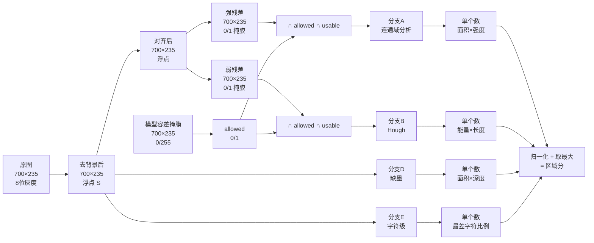

---

## 五、关键参数速查

| 参数 | 默认 | 作用 |
|---|---|---|
| `sigma` | 15 | 去背景高斯尺度 |
| `strokeHi` | 0.35 | 强笔画阈值（分支 A、E） |
| `strokeLo` | 0.20 | 弱笔画阈值（分支 B） |
| `pKeep` | 0.20 | 频率门槛，生成容差掩膜 |
| `dilateK` | 9 | 容差掩膜膨胀核 |
| `edgeTB` / `edgeLR` | 25 / 10 | 边缘屏蔽宽度 |
| `eccMin` | 0.60 | 字符区配准门槛 |
| `codeEccMin` | 0.55 | code 区配准门槛 |
| `scratchT` | 逐视角 | 划痕归一化分母 |
| `appendageT` | 210 | 多余笔画归一化分母 |
| `scratchMinCoverage` | 0.25 | 划痕密度门槛 |
| `scratchMinLen` | 160 | 划痕长度门槛 |
| `missFreq` | 0.50 | "必然有墨"频率门槛 |
| `missStrokeLo` | 0.15 | "墨缺失"信号门槛 |
| `missMinArea` | 30 | 缺墨最小面积 |
| `missT` | 900 | 缺墨归一化分母 |
| `charMissRatio` | 0.15 | 单字符缺墨比例门槛 |
| `charExtraRatio` | 0.12 | 单字符多余墨比例门槛 |
| `checkCode` | **0** | 检测（本版本关闭） |
| `checkMissing` | 1 | 缺墨检测（需重新建模才生效） |
| `checkChars` | 1 | 字符级比对（需重新建模才生效） |

---

## 六、当前生效状态

| 功能 | 代码 | 是否生效 | 说明 |
|---|---|---|---|
| 多余笔画 | ✅ | ✅ | logo 区 |
| 连续划痕 | ✅ | ✅ | 全区域 |
| 笔画粗细 | ✅ | ❌ | 本版本关闭 |
| 缺墨断线 | ✅ | ❌ | 需重新建模 |
| 字符级比对 | ✅ | ❌ | 需重新建模，且需 `chars_*.txt` |
| 表面划痕 | ❌ | ❌ | 已删除 |

要让后两项生效，需要重新训练生成模型（或手工补 `chars_*.txt` 并调整 `params.txt`）。
