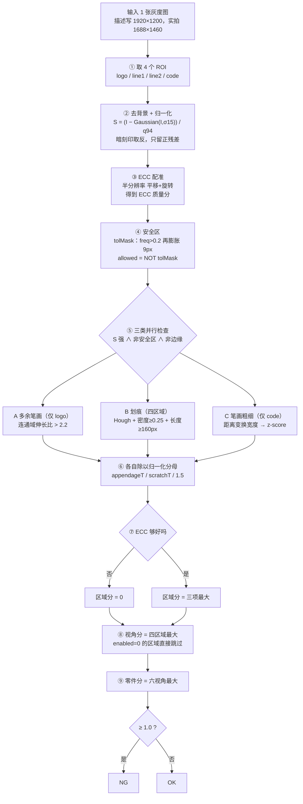

# 刻印缺陷检测 · 算法实现步骤与示意图

> 写给第一次接触这套代码的人。每一步都回答三件事：**做什么 → 怎么做 → 为什么这么做**。
>
> - 所有中间图都是用真实数据跑出来的（`tools/run_algo_figures.py`，逐函数对齐 `src/core/*.cpp`），
>   不是手绘示意；图里的数值就是实测值。
> - 与原始口头描述**不一致**的地方单独列在第 8 节，避免踩坑（例如"1920×1200"）。
> - 判定细节的权威说明仍是 [DECISION_LOGIC.md](DECISION_LOGIC.md)，本文侧重"怎么实现、长什么样"。

---

## 〇、一图看全流程


对应的 Mermaid 源码（可贴到 mermaid.live / GitHub / Typora）：



伪代码（与 `analyze()` / `analyzeProduct()` 一一对应）：

```text
for view v in 0..5:                       # 六个视角各有一套模型和参数
  for roi in [logo, line1, line2, code]:
    if not roi.enabled: continue          # 该视角下此区域被关掉
    S      = strokeSignal(gray, roi)      # ② 去背景 + 归一化
    T, ecc = findTransformECC(S, ref[v])  # ③ 对到模型坐标系
    A      = warp(S, T)
    maskOK = (A > strokeHi) & !tolMask & usable & (A > strokeLo)
    a = aScore(A, maskOK_strong)          # A 多余笔画（仅 logo）
    b = bScore(A, maskOK_weak)            # B 划痕（注意用的是弱阈值）
    c = cScore(A)                         # C 笔画粗细（仅 code）
    score = max(a/appendageT, b/scratchT, c)      # ⑥
    if ecc < (codeEccMin if roi==code else eccMin): score = 0   # ⑦
    viewScore = max(viewScore, score)              # ⑧
  productScore = max(productScore, viewScore)      # ⑨
NG = productScore >= 1.0
```

---

## 第 1 步 · 只看刻字的地方（ROI）


**做什么**：一张整图里只取四个矩形，其余全部丢弃。

**怎么做**：`Params::Params()`（`char_core.hpp`）里写死 `cv::Rect`，随模型存进 `models/char/vNN/params.txt` 的 2~5 行：

| 区域 | 内容 | Rect(x, y, w, h) | 特殊行为 |
|---|---|---|---|
| `logo` | 厂商标识 | (480, 325, 700, 235) | 唯一开启"多余笔画"检查的区域 |
| `line1` | 型号行 | (390, 780, 870, 180) | 用于自动判定极性与 ROI 标定 |
| `line2` | 批号行 | (490, 945, 660, 175) | — |
| `code` |  + 圆圈 | (430, 550, 320, 260) | 不能比模板，只能比笔画粗细；ECC 门槛更低 |

**为什么**：引脚、塑封体边缘、pin1 圆点天生就有强烈明暗变化，不先框掉会疯狂误报。ROI 也直接把要处理的数据量砍掉 95% 以上。

> 注意：ROI 是**绝对像素坐标**。换相机分辨率必须重新标定（`autoCalibrateRois()` 可以用视角 0 的 line1 做多尺度模板匹配，把 ROI 映射到其他视角）。

---

## 第 2 步 · 抹掉背景，只留"突出来的东西"


**做什么**：把图像变成"笔画信号 S"——一个只有笔画处数值大、其余接近 0 的浮点图。

**怎么做**：`strokeSignal()`（`char_core.cpp:31`）。

```
patch = gray(roi)                       # ① 取 ROI，转 float
bg    = GaussianBlur(patch, σ = 15)     # ② 平滑背景（相当于"这一带的平均亮度"）
d     = patch − bg                      # ③ 残差：只留比周围突出的
if invert: d = −d                       # ④ 暗刻印（凹字）取反，让笔画变正
q94   = 残差直方图的 94% 分位            # ⑤ 统计这张图自己的残差分布
scale = max(8.0, q94)                   #    下限 8，防止全黑图把噪声放大
S     = max(d / scale, 0)               # ⑥ 归一化，并丢掉所有负残差
```

实测（0110 · v00 · line1）：q94 = 105，scale = 105，残差范围 [−93, +161]，S 最大 1.54。

**为什么**：
- 直接找"亮的像素"，整片亮区域都会被选成字；减去模糊图后只剩"比周围突出的细笔画"。
- 取反是为了暗刻印：不取反算法只认亮字，暗视角会全部失效（极性由建模时自动判定，存成 `params.txt` 第 16 个字段 `invert`）。
- 除以 94 分位 = 用这张图自己的残差分布当尺子。不同打光下笔画残差能差好几倍，归一化之后六个视角才能共用 `strokeHi=0.35` / `strokeLo=0.20` 一套阈值。


---

## 第 3 步 · 把图对齐到模型的位置（ECC）


**做什么**：芯片每次放上载物台都会偏移几个到几十像素，先把它和模型基准对齐，否则笔画全部错开、满屏都是"差异"。

**怎么做**：`estimateWarp()` + `applyWarp()`（`warp.cpp`）。

```
a = S 缩到 0.5×, b = sRef 缩到 0.5×            # 半分辨率，速度约 4 倍
ecc, M = findTransformECC(b, a, MOTION_EUCLIDEAN, 100 次迭代)   # 平移 + 旋转
M 的平移分量 ×2 还原到全分辨率
aligned = warpAffine(S, M, WARP_INVERSE_MAP, BORDER_REPLICATE)
```

实测：0110 v00 line1 相对基准 dx = +2.76, dy = +7.24 px，ECC = 0.928；把同一张图人为再平移 (−5, +7) px 后重新配准，ECC = 0.925——偏移被吃掉了。平均绝对差异从 0.216（未对齐）降到 0.074（对齐后）。

**为什么**：ECC 不只是一个参考数字，它是一个**否决开关**：`ecc < eccMin(0.60)` 时该区域所有差异都来自错位，分数直接清零。code 区内容逐颗不同，配准天然偏差，因此用更低的 `codeEccMin(0.55)`，但**不豁免**——实测 v03/v04 的code 区 ECC 只有 0.48~0.53，放行会让噪点连成的假线计分。

---

## 第 4 步 · 划出"安全区"


**做什么**：预先知道"正常芯片的笔画该出现在哪些像素"，把这些位置围成一片安全区；安全区里出现再强的残差也不算缺陷。

**怎么做**：建模时统计频率图 → 检测时使用固化好的容差图。

```
# 建模阶段（buildModel，每个区域每张 OK 样本都对齐到 sRef 后累加）
freq   = 该像素在多少比例的 OK 样本里 S > strokeHi      # 频率图，0~1
keep   = freq > pKeep (0.20)                            # 经常有笔画的区域
tolMask= dilate(keep, 椭圆核 9×9)                        # 往外扩一圈，容忍对位抖动
存成 {roi}_freq.png / {roi}_tol.png

# 检测阶段（analyze）
allowed = NOT (tolMask > 127)                           # 容差区内不报
usable  = 去掉上下 edgeTB=25px、左右 edgeLR=10px        # 边缘屏蔽
可疑    = (S > 阈值) ∧ allowed ∧ usable
```

实测：0110 v00 logo 区有 29.3% 的像素落在容差区里（整块字都在其中），排除后只剩 **298 px** 可疑像素——而这些像素里恰好藏着一块真实的多余墨迹（见第 5 步）。

**为什么**：这一步排除了绝大多数误报——字本身不会被当成缺陷，边缘的亮度突变被直接屏蔽。**代价**是安全区越宽越容易漏掉"贴着字边"的真缺陷，`pKeep` 与 `dilateK` 调的就是这个平衡。

---

## 第 5 步 · 把可疑的东西分成三类


三个检查并行，各自产出一个"原始量"。注意划痕分支用的是**弱阈值**的掩膜，另两个用强阈值。

### ① 多余笔画 `scoreAppendage()` —— 只在 logo 区

```
连通域分析（8 邻接）→ 面积 < 15px 丢弃
PCA 特征值 → 伸长比 sqrt(λ1/λ2) ≤ 2.2 → 判为圆形污点，丢弃
原始量 = 面积 × 该连通域平均 S，取所有连通域的最大值
```

实测（0110 v00 logo）：最大连通域面积 269 px、伸长比 2.33、平均 S 0.86 → **原始量 230.8**，形状上确实是一道贴着字母笔画的细长墨迹。

**为什么只用 logo**：其他区域多出来的墨通常表现为划痕，形状判据会把划痕也判成"笔画"。

### ② 划痕 `scoreScratch()` —— 四个区域都做

```
HoughLinesP(weak, 阈值20, 最小30px, 最大间隙60) → 得到候选直线
逐条线沿线等步长采样：
  energy   = Σ max(S − strokeLo, 0)     在 ±4px 的带宽内累加
  coverage = ±1px 窄带内有残差的采样点占比
coverage < 0.25 → 噪点连成的假线，丢弃
score = energy × 长度
长度 ≥ 160px → 写入 scratchSevere（参与判定）；否则只记录不算分
```

**为什么用长度而不是亮度**：实测严重划痕"很长但很淡"（225 px），小瑕疵"很短但很亮"（≤121 px）。用亮度当门槛会漏掉真缺陷、留下小毛病；用长度刚好反过来。短划痕允许放行是**故意的**。

### ③ 笔画粗细 `measureCode()` —— 只在 code 区


```
二值化 S > strokeHi → 3×3 开运算去噪
距离变换：每点到背景的距离，2 × dist = 局部笔画宽度
widthMedian = 所有笔画像素宽度的中位数      ← 这颗芯片的"正常粗细"
超粗阈值 = max(1.6 × 中位, 中位 + 3)
thickRatio = 超粗像素数 / 笔画像素数
z = (thickRatio − 建模均值) / max(建模标准差, 0.005)
区域分 = max(0, z − zDead) / 1.5，zDead = max(0.5, codeZNg − 1.5)
```

实测（0110 v00 code 区，**仅作演示**）：宽度中位数 6.0 px，超粗像素占 22.3%；模型 `code_stats.txt` 里 `thickMean=0.152, thickStd=0.028` → z = 1.63，低于死区 2.0，所以得 0 分。

**为什么不能比模板**：每颗产品都不同（`7/HU`、`8/JB`……），模板比对会把正常差异算成缺陷（实测误报从 2 颗涨到 17 颗）。唯一稳定的特征是**笔画粗细恒定**，糊成一团会导致局部特别粗。

> ⚠️ 当前模型里 `checkCode = 0`（`params.txt` 第 14 个字段），本分支**整体关闭**，code 区只走划痕分支。上面的演示用的是默认参数 `checkCode=1`。

---

## 第 6 步 · 算分：除以归一化分母


| 检查 | 原始量 | 归一化 | 默认分母 |
|---|---|---|---|
| A 多余笔画 | 面积 × 平均强度 | ÷ `appendageT` | 210（固定） |
| B 划痕 | 能量 × 长度 | ÷ `scratchT` | 逐视角标定 |
| C 笔画粗细 | z-score | (z − 死区) ÷ 1.5 | 固定 |
| （D 缺墨 / E 字符级） | 面积×深度 / 缺失比例 | ÷ `missT` / `charT` | 当前关闭 |

**区域分 = 三项的最大值。**

分母逐视角标定，因为各视角打光强度差很多：


| 视角 | v00 | v01 | v02 | v03 | v04 | v05 |
|---|---|---|---|---|---|---|
| `scratchT` | 41573 | 22000 | 34889 | 90708 | 75136 | 19462 |

最大/最小差约 4.7 倍。所以"1.0 分"在不同视角代表的绝对残差量不同，**视角分只适合在本视角内比较**。

0110 v00 的实算：

| 区域 | ECC | A：面积×强度/210 | B：能量×长度/41573 | 区域分 |
|---|---|---|---|---|
| logo | 0.872 | 231 / 210 = **1.10** | 0 / 41573 = 0.00 | **1.099** |
| line1 | 0.928 | —（仅 logo） | 0.00 | 0.000 |
| line2 | 0.944 | —（仅 logo） | 0.00 | 0.000 |
| code | 0.264 | — | 0.00 | 0.000（ECC 不足 + 崩缺关闭） |

---

## 第 7 步 · 聚合与最终判定


```
区域分 = max(A, B, C)
if ecc < 门控: 区域分 = 0            # 字符区 0.60，code 区 0.55
视角分 = max(四个区域分)              # enabled=0 的区域、enabled=0 的视角直接跳过
零件分 = max(六个视角分)
零件分 >= 1.0  → NG ；否则 OK
```

实测（0110）：v00 = 1.099，v01..v05 = 0 → 零件分 **1.099 → NG**，与 C++ 评估结果一致（`out/baseline_3view.txt` 中 0110 为 1.10）。

**为什么取最大而不是投票/平均**：只要有任何一个视角的任何一个区域报了，就是 NG。这个设计偏保守——宁可错杀。产线上漏检代价通常远大于误报。代价是 OK 余量薄：OK 最高分 0116 = 0.927，离 1.0 只有 0.073（DECISION_LOGIC.md §9）。

---

## 第 8 步 · 与原始描述不一致 / 容易踩的坑

| # | 原始描述 | 代码实际 | 影响 |
|---|---|---|---|
| 1 | 一张图 **1920×1200** | 实拍图与 `params.txt` 里的 ROI 都是 **1688×1460** | ROI 是绝对像素坐标，直接套 1920×1200 会框错位置 |
| 2 | "暗字取反，让暗字也变成正数" | 取反是**每视角一个开关**（`invert`），建模时只用 line1 自动判定一次 | 一个视角里若亮暗笔画混存，只能二选一 |
| 3 | 三类检查取最大 | 当前模型 **`checkCode=0`**，笔画粗细**整体关闭**；`checkMissing=0`，缺墨分支也关闭 | 实际生效的是：logo 多余笔画 + 四区域划痕（+ 字符级，若有字符框） |
| 4 | 多余笔画用强阈值 | 划痕用的是**弱阈值** `strokeLo=0.20` 的掩膜 | 强掩膜只给 A、C、D、E 用 |
| 5 | 糊成一团 | 崩缺分支用**未配准**的原始 S 算宽度 | 设计如此（逐颗不同），但因此容易受位置影响 |
| 6 | "不同视角分母差好几倍" | 只有 `scratchT` 逐视角标定；`appendageT=210` 六视角相同 | 多余笔画分支没有逐视角校准 |
| 7 | 字符级比对 / 缺墨检测 | 代码里有（`matchChars` / `scoreMissing`），但 `chars_*.txt` 不存在、`checkMissing=0` | 当前不生效，`ALGORITHM_STEPS.md` 标为 `[未激活]` |
| 8 | — | `freq` 图**读了但不直接参与检测**，判定全部依赖固化好的 `_tol.png` | 手工改 freq 不同步改 tol 不会生效 |
| 9 | — | `code_stats.txt` 缺失时崩缺分支**静默返回 0**，不报错 | 见 IMPROVEMENTS.md P0-4 |
| 10 | — | ECC 调的是 `findTransformECC(b8=ref, a8=current)` 且用 `WARP_INVERSE_MAP` 反向采样 | 方向与 OpenCV 文档示例相反，实测能正确对齐（差异 0.216→0.074），但改代码前要清楚这一点 |

---

## 附录 A · 参数速查（`models/char/vNN/params.txt`）

| 位置 | 参数 | 值 | 作用 |
|---|---|---|---|
| 1 | `sigma` | 15 | 去背景高斯尺度 |
| 2 | `strokeHi` | 0.35 | 强笔画阈值（A / C / 字符级） |
| 3 | `strokeLo` | 0.20 | 弱笔画阈值（B 划痕） |
| 4 | `pKeep` | 0.20 | 生成容差图的频率门槛 |
| 5 | `dilateK` | 9 | 容差图膨胀核（奇数） |
| 6/7 | `edgeTB` / `edgeLR` | 25 / 10 | 边缘屏蔽宽度 |
| 8 | `scratchT` | 逐视角 | 划痕归一化分母 |
| 9 | `appendageT` | 210 | 多余笔画归一化分母 |
| 10 | `eccMin` | 0.60 | 字符区配准门槛 |
| 11 | `scratchMinCoverage` | 0.25 | 划痕密度门槛 |
| 12 | `scratchMinLen` | 160 | 划痕长度门槛（px） |
| 13 | `codeZNg` | 3.5 | 崩缺 z 门槛（死区 = max(0.5, z−1.5)） |
| 14 | `checkCode` | **0** | 笔画粗细开关（本模型关闭） |
| 15 | `enabled` | 1 | 视角是否参与 |
| 16 | `invert` | 0 | 暗刻印取反 |
| 17 | `checkMissing` | 0 | 缺墨分支开关 |
| 18 | `codeEccMin` | 0.55 | code 区配准门槛 |
| 19~26 | miss/char 一组 | — | 缺墨与字符级参数（当前未启用） |
| 27~30 | ROI × 4 | 见第 1 步 | x y w h enabled |

全局常量：`kNgThreshold = 1.0`（`char_core.hpp`）。

## 附录 B · 图怎么重新生成

```powershell
python tools\run_algo_figures.py      # 01..07 各步骤图 + figures.json（实测数值）
python tools\draw_flow_svg.py         # 00_flow.svg / 00_flow.png 总览图
```

依赖：`opencv-python`、`numpy`、`matplotlib`（仅工具链）。数据来源：`models/char/vNN/*`、`image/ng/0110_*_00.tif`；图片渲染脚本逐函数复刻了 `strokeSignal / estimateWarp / scoreAppendage / scoreScratch / measureCode` 的打分逻辑，复算出的零件分 1.099 与 C++ 评估输出的 1.10 吻合。
