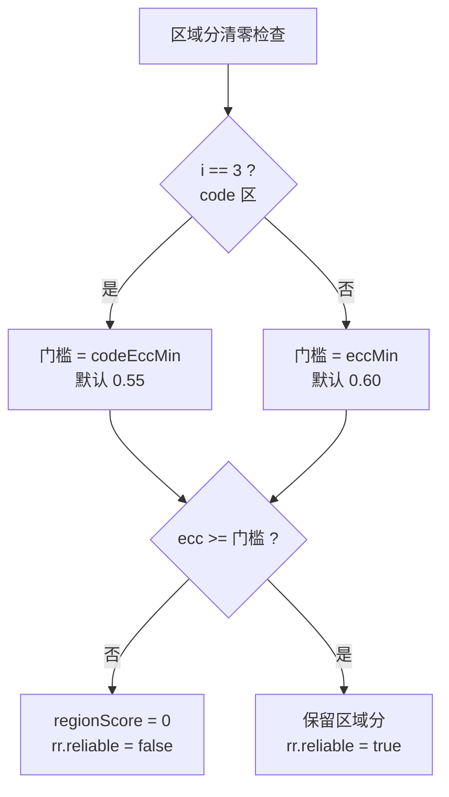

# markloc 判定逻辑汇总

> 本文汇总**所有影响 OK/NG 判定的规则**，是判定行为的唯一权威说明。
> 算法细节见 `FLOWCHART.md`，模型数据结构见 `MODEL_DATAFLOW.md`，本文只讲"凭什么判"。
>
> 通用常量：`kNgThreshold = 1.0`（分数 ≥ 1.0 判 NG）。

---

## 一、判定链路总览

判定是**三层聚合**，每一层都取最大值：

```
四个区域分  →  视角分 = max(四区域)  →  零件分 = max(各视角)
                                           ↓
                                      ≥ 1.0 ?  NG : OK
```

任何一层取 max 意味着：**只要有一个区域报了，整个零件就是 NG**。不存在"多数投票"或"平均"。

---

## 二、区域分：三个检测分支

每个区域独立计算，最终区域分是这三个分支结果的组合。

### 分支 A — 多余笔画（仅 logo 区）

| 项 | 值 |
|---|---|
| 启用条件 | `roi.checkAppendage = true`（只有 logo 区为 true） |
| 输入 | `extra` 掩膜（S > `strokeHi` 且容差区外且非边缘） |

**判定规则**：

```
1. 连通域分析（8 邻接）
2. 面积 < 15 px          → 丢弃
3. PCA 特征值比          → sqrt(λ1/λ2) ≤ 2.2 则丢弃（判为圆形污点）
4. 得分 = 面积 × 该连通域内的平均 S
5. 取所有连通域的最大值 → appendage
6. 归一化：appendage / appendageT     （默认 appendageT = 210）
```

**设计依据**：用伸长比区分"笔画状的多余墨迹"和"圆形颗粒/污点"。

### 分支 B — 连续划痕（全部区域）

| 项 | 值 |
|---|---|
| 启用条件 | 始终启用（除 code 区被覆盖外） |
| 输入 | `weak` 掩膜（S > `strokeLo` 且容差区外且非边缘） |

**判定规则**：

```
1. HoughLinesP 找候选线段（阈值 20 / minLen 30 / maxGap 60）
2. 逐条线沿线采样：
   - energy    = Σ max(S − strokeLo, 0)   （±4px 带内累加）
   - coverage  = ±1px 窄带内有残差的采样点占比
3. coverage < scratchMinCoverage (0.25)  → 丢弃（噪点连线）
4. score = energy × len
5. 只有当 len ≥ scratchMinLen (160px) 时，才写入 scratchSevere
6. 区域分 = scratchSevere / scratchT      （scratchT 逐视角独立）
```

**关键细节**：`rr.scratch`（最佳记录）无论长度都会更新，但**不参与判定**；
真正参与判分的只有 `scratchSevere`——即**只有长度达标的划痕才算数**。

**设计依据**：实测严重缺陷是"长而淡"（225px），轻微瑕疵是"短而亮"（≤121px）。
所以用**长度**而非强度作门槛，能同时把误报清零又保住真缺陷。

### 分支 C — 笔画粗细（仅 code 区）

| 项 | 值 |
|---|---|
| 启用条件 | `i == 3` 且 `p.checkCode == true` |
| 输入 | `sImg`（未配准的原始笔画信号）+ `codeStat` |

**判定规则**：

```
1. 二值化 S > strokeHi，再做 3×3 开运算
2. 距离变换：2 × dist = 局部笔画宽度
3. 取宽度中位数作为正常基线
4. 超粗阈值 = max(1.6 × 中位, 中位 + 3)
5. thickRatio = 超粗像素数 / 笔画像素数
6. z = (thickRatio − codeStat.thickMean) / max(codeStat.thickStd, 0.005)
7. zDead = max(0.5, codeZNg − 1.5)
8. 区域分 = max(0, z − zDead) / 1.5
```

**为什么不用模板比对**：每颗产品内容不同（`7/HU`、`8/JB`），模板比对会把正常差异
算成缺陷，误报从 2 颗涨到 17 颗。唯一稳定特征是**笔画粗细恒定**。

> ⚠️ `codeStat.valid == false` 时此分支**直接返回 0 且不报警**，等于静默失效。

### 区域分的组合方式

| 区域 | 计算方式 |
|---|---|
| logo | `max(scratchSevere / scratchT, appendage / appendageT)` |
| line1 | `scratchSevere / scratchT` |
| line2 | `scratchSevere / scratchT` |
| code | **被覆盖**为 `scoreCode(...)`（若 `checkCode=0` 则仍用划痕分） |

---

## 三、可靠性门控：分数可能被清零

算出来的分数不一定算数。门控在最后一步执行。



**ecc 是什么**：ECC 配准质量，取值约 [0, 1]。低于门槛意味着当前图像和模型没对齐，
此时的残差是错位伪差而非真实缺陷。

**code 区为何门槛更低**：内容逐颗不同，配准天然偏差。但**不能无条件豁免**——
实测 v03/v04 的code 区 ECC 只有 0.48~0.53，若放行会让噪点连成的伪线被计分。

---

## 四、视角分与零件分

### 视角分

```
视角分 = max(四个区域的区域分)
视角 NG = 视角分 >= 1.0
```

### 零件分

两条路径，行为一致性上有细微差别：

| 路径 | 实现 | 聚合方式 |
|---|---|---|
| core 库 | `analyzeProduct()` | `max(各视角 regionMax, 互证通过的 surfaceScore)` |
| GUI 评估 | `TrainWindow::evaluateAndShow` | 按料号聚合，取该料号所有图的最高分 |

两者对同一数据集给出的结果一致，因为表面分支当前恒为关闭（所有视角 `useSurface=0`）。

### 表面分支（当前关闭）

```
1. 全芯片大 ROI 上一次 Hough
2. coverage >= 0.45 且 len >= surfMinLen (200)
3. 多视角互证：同一位置 ≤60px 且同方向 ≤30° 在 ≥2 视角出现
4. 产品分 = max(regionScore, surfaceScore)
```

**为何关闭**：v00 与 v02 打光接近、噪声同源，两视角在相似位置出假线是必然的，
实测会把 10 颗 OK 误判。

---

## 五、信号层面的隐含判定

有一条规则不在分支代码里，但决定了所有分支的输入——`strokeSignal()` 的**双阈值截断**：

```
S = clamp((I − Gaussian(I, σ)) / scale, 0, +∞)
```

- **只取正残差**：`threshold(S, 0, TOZERO)` 丢弃所有负值，即只找"比背景亮"的笔画
- **极性可翻转**：`invert=1` 时先取负，适配"暗刻印"视角（v01）
- **归一化尺度自适应**：`scale = max(8.0, q94)`，q94 是残差直方图的 94 分位

第三条让六个不同曝光的视角能共用同一组阈值。但也是 v01 出问题的根源——
背景亮度梯度会主导 q94，导致真实笔画被压小。

---

## 六、区域开关：判定可能被完全跳过

`Roi::enabled` 控制某视角下某区域是否参与。

```cpp
if (!roi.enabled) continue;   // analyze() 循环开头
```

**当前配置**：

| 视角 | logo | line1 | line2 | code | 说明 |
|---|---|---|---|---|---|
| v00 | ✅ | ✅ | ✅ | ✅ | 全开 |
| v01 | ❌ | ✅ | ✅ | ✅ | logo 区关闭 |
| v02 | ✅ | ✅ | ✅ | ✅ | 全开 |
| v03 | ❌ | ✅ | ✅ | ✅ | logo 区关闭 |
| v04 | ❌ | ✅ | ✅ | ✅ | logo 区关闭 |
| v05 | ✅ | ✅ | ✅ | ✅ | 全开 |

**关闭原因**：v01/v03/v04 的 logo 区被背景亮度梯度主导。实测 v01 logo 区里，
真 NG（0110）的 appendage 分 0.128 **反而低于** OK（0116）的 1.251，
说明该分支在这些视角测的不是缺陷。

关闭后三个视角均达到 FP=0。

---

## 七、真值来源：评估时的"标准答案"如何认定

判定逻辑之外，评估需要知道每张图本应是 OK 还是 NG。

`inferTruth()` 按优先级：

```
1. 父目录名（含向上 3 级）："ok" → OK,  "ng" → NG
2. 文件名含 "_FAILED" 或 "_NG"  → NG
3. 文件名含 "_PASS" 或 "_OK"    → OK
4. 都不满足 → 无标签（只判不评）
```

**注意**：目录约定优先于文件名。所以文件名带 `_Failed` 但放在 `ok/` 目录里，会被判为 OK
（0116 就是这种情况）。

---

## 八、完整判定规则速查表

| # | 判定点 | 条件 | 结果 |
|---|---|---|---|
| 1 | 区域是否启用 | `roi.enabled == false` | 该区域不参与，分数不存在 |
| 2 | 模型区域有效 | `mr.ok == false` | 跳过该区域 |
| 3 | ROI 越界 | 超出图像边界 | 跳过该区域 |
| 4 | 模板尺寸 | `tolMask.size() != aligned.size()` | 跳过该区域 |
| 5 | 多余笔画面积 | `< 15 px` | 丢弃该连通域 |
| 6 | 多余笔画形状 | `sqrt(λ1/λ2) <= 2.2` | 判为圆形污点，丢弃 |
| 7 | 划痕密度 | `coverage < 0.25` | 判为噪点连线，丢弃 |
| 8 | 划痕长度 | `len < 160 px` | 不写入 severe，不影响判定 |
| 9 | 统计缺失 | `codeStat.valid == false` | 分支返回 0（静默失效） |
| 10 | ECC 门控 | `ecc < 门槛` | 区域分清零 |
| 11 | 区域分聚合 | — | `max(各分支)` |
| 12 | 视角分聚合 | — | `max(四区域)` |
| 13 | 零件分聚合 | — | `max(各视角)` |
| 14 | **最终判定** | `零件分 >= 1.0` | **NG**，否则 **OK** |

---

## 九、当前模型的实际判定能力

基于 `models/char`（即 `models/baseline_0116ok` 同一配置）：

| 指标 | 结果 |
|---|---|
| 按图 | TP=13 FP=0 FN=35 TN=504 |
| 按零件 | TP=4 FP=0 FN=0 TN=42 |
| 正确率（按零件） | 100% |

**余量分析**（决定判定的离阈值有多远）：

| 项 | 分数 | 距阈值 1.0 |
|---|---|---|
| OK 最高（0116） | 0.927 | 余量 0.073 |
| NG 最低（0110） | 1.099 | 余量 0.099 |

余量很薄，换批次容易失稳。这是当前配置的主要风险。

---

## 十、三个会导致"看起来正常但实际失效"的坑

| 坑 | 现象 | 检测方法 |
|---|---|---|
| `code_stats.txt` 缺失 | 笔画粗细检测静默返回 0，无报错 | 检查文件是否存在 |
| `_freq.png` 读了不用 | 手工改 freq 不同步改 tol 不生效 | 容差已固化在 `_tol.png` |
| `surfOk = false` | 表面分支静默跳过 | 检查 surf_ref/surf_tol 尺寸一致 |

---

## 十一、参数速查

| 参数 | 默认 | 影响的判定 |
|---|---|---|
| `kNgThreshold` | 1.0 | 最终判定阈值（全局常量，不可按视角改） |
| `strokeHi` | 0.35 | 分支 A 的输入强度 |
| `strokeLo` | 0.20 | 分支 B 的输入强度 |
| `scratchMinCoverage` | 0.25 | 划痕密度门槛 |
| `scratchMinLen` | 160 | 划痕长度门槛 |
| `scratchT` | 逐视角 | 划痕分分母（越大越宽松） |
| `appendageT` | 210 | 多余笔画分分母（越大越宽松） |
| `codeZNg` | 3.5 | 崩缺 z-score 死区起点 |
| `eccMin` | 0.60 | 字符区配准门槛 |
| `codeEccMin` | 0.55 | code 区配准门槛 |
| `edgeTB` / `edgeLR` | 25 / 10 | 边缘屏蔽（屏蔽区不参与判定） |
| `checkCode` | 1 | 是否检测code 区 |
| `enabled` | 1 | 视角是否参与零件判定 |
| `invert` | 0 | 信号极性 |
| `useSurface` | 0 | 表面分支开关 |

---

## 十二、与其他文档的关系

| 文档 | 内容 |
|---|---|
| **本文** | 判定规则（唯一权威） |
| `FLOWCHART.md` | 识别流程与数据流图 |
| `MODEL_DATAFLOW.md` | 模型加载、内存结构、参数映射 |
| `VIEW_ENABLEMENT.md` | v01/v03/v04 启用的诊断过程与证据 |
| `IMPROVEMENTS.md` | 已知缺陷与改进清单 |
