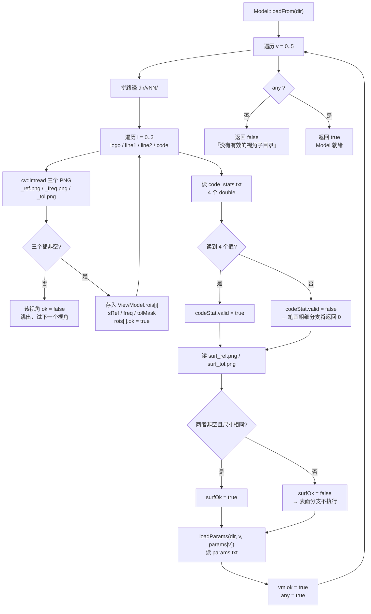
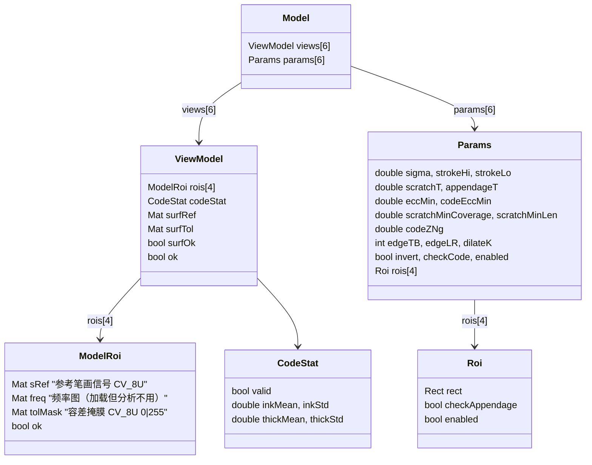
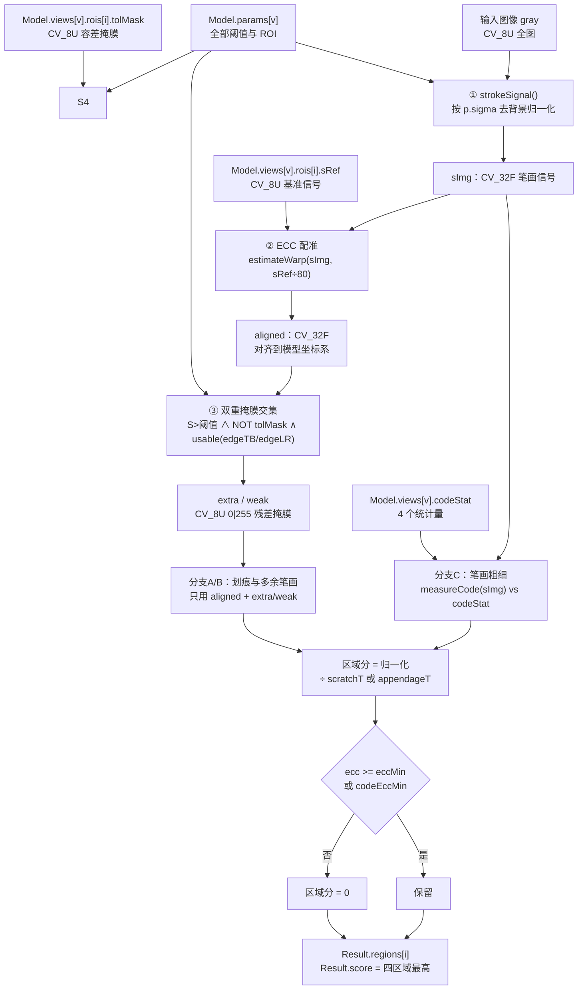
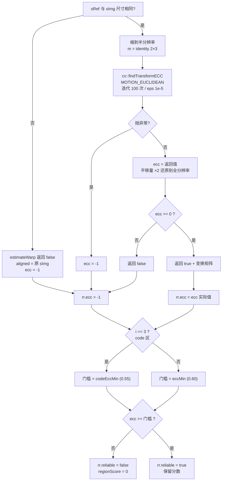
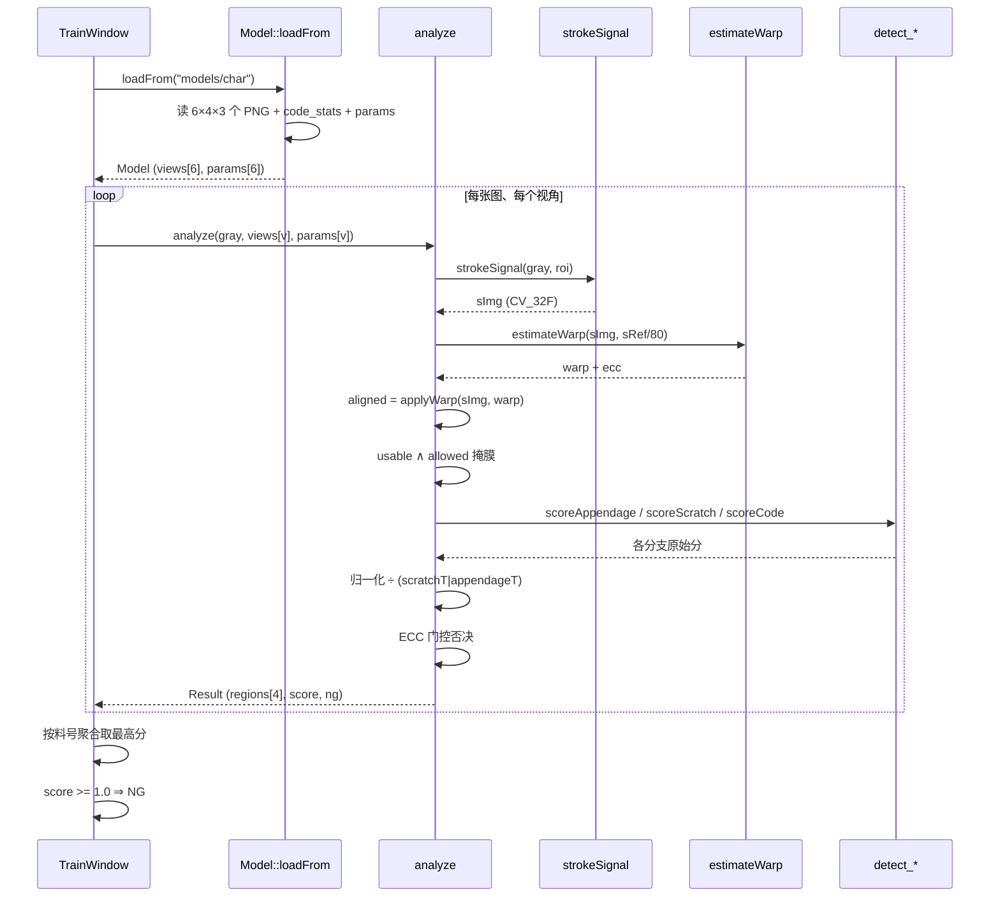

# 模型加载 → 识别 数据流

> 只覆盖「模型从磁盘读入内存」到「产出判定结果」这一段。
> 不含训练侧（buildModel 写模型），不含 GUI 评估的统计逻辑。
> 代码位置：`src/core/char_core.cpp` 的 `Model::loadFrom()` 与 `analyze()`。

---

## 一、模型在磁盘上的形态

```
models/char/
├── v00/
│   ├── logo _ref.png      参考笔画信号    ← 配准基准
│   ├── logo _freq.png     正常笔画频率    ← 加载但分析时不直接用
│   ├── logo _tol.png      容差掩膜        ← 决定"哪些地方不报"
│   ├── line1_ref/freq/tol.png
│   ├── line2_ref/freq/tol.png
│   ├── code _ref/freq/tol.png
│   ├── code_stats.txt     inkMean inkStd thickMean thickStd
│   ├── surf_ref.png       全芯片表面参考（可选）
│   ├── surf_tol.png       全芯片表面容差（可选）
│   └── params.txt         17+ 个标量 + 4 行 ROI
└── v01/ … v05/  同上
```

**关键区分**：`_ref`、`_freq`、`_tol` 三个文件里，**识别过程只用 `_ref` 和 `_tol`**。
`_freq` 会被读进内存（`ModelRoi::freq`），但 `analyze()` 不引用它——容差判定已经在建模时固化进 `_tol` 了。

---

## 二、加载：磁盘 → 内存结构



### 加载后的内存结构



**注意**：`Params` 与 `ViewModel` 是**两个平行数组**，都在 `Model` 里但互不引用。
`analyze()` 把两者同时传入，参数决定"怎么算"，模板决定"和谁比"。

---

## 三、识别：模型数据如何参与计算

这是数据流的核心。模型的三类数据分别进入不同的处理环节。



### 模型数据的三条去向

| 模型数据 | 被谁使用 | 用途 |
|---|---|---|
| `rois[i].sRef` | `estimateWarp` | **仅作 ECC 配准基准**，不参与像素比对 |
| `rois[i].tolMask` | `allowed = NOT tolMask` | 决定残差掩膜里哪些像素被排除 |
| `rois[i].freq` | **无** | 加载但识别时不使用 |
| `codeStat` | `scoreCode` | 提供正常笔画粗细的均值/标准差，用于 z-score |
| `params[v]` | 全流程 | 所有阈值、ROI 坐标、门控门槛 |

**一个容易误解的点**：`sRef` 不是"模板匹配"意义上的模板。
识别过程**从不把当前图像和 `sRef` 做像素差**。`sRef` 只用来算一个欧氏变换矩阵，
让当前图像对齐到建模时的坐标系。真正的"比对"全部发生在 `tolMask` 上。

---

## 四、逐区域的数据形态变化

以 logo 区（700×235）为例，走一遍数据尺寸与类型的变化：

```mermaid
flowchart LR
    A["gray<br/>全图 CV_8U"] -->|"roi.rect 裁剪"| B["patch<br/>700×235 CV_32F"]
    B -->|"GaussianBlur + 减 + 归一化"| C["sImg<br/>700×235 CV_32F<br/>值域 [0, +∞)"]
    C -->|"×80 量化"| C2["sRef 加载回来<br/>700×235 CV_8U"]
    C2 -->|"÷80 还原"| C3["refF<br/>700×235 CV_32F"]

    C -->|"输入"| D["estimateWarp<br/>半分辨率 350×117"]
    C3 -->|"输入"| D
    D -->|"2×3 变换矩阵 + ecc 标量"| E["aligned<br/>700×235 CV_32F"]

    E -->|"S > strokeHi"| F["强残差 bool"]
    E -->|"S > strokeLo"| G["弱残差 bool"]
    F -->|"∧ allowed ∧ usable"| H["extra<br/>700×235 CV_8U 0|255"]
    G -->|"∧ allowed ∧ usable"| I["weak<br/>700×235 CV_8U 0|255"]

    H -->|"连通域 + PCA"| J["appendage 标量<br/>面积×平均强度"]
    I -->|"Hough + 密度 + 长度"| K["scratchSevere 标量<br/>能量×长度"]

    J -->|"÷ appendageT"| L["logo 区域分"]
    K -->|"÷ scratchT"| L
    L -->|"取 max"| M["Result.score<br/>CV 无关，纯 double"]
```



---

## 五、门控：模型质量如何影响结果

`ecc` 是唯一一个"由模型与图像的匹配质量决定"的量，它反过来否决分数。



**设计意图**：`ecc` 低于门槛意味着图像和模型根本没对齐，此时的残差是错位导致的伪差，
不是真实缺陷。code 区门槛更低是因为内容逐颗不同，配准天然偏差。

---

## 六、一次完整调用的数据流（端到端）



---

## 七、模型参数与识别行为的对应关系

| 模型里存的 | 影响识别的哪里 | 调大后的效果 |
|---|---|---|
| `sRef` 像素内容 | ECC 配准质量 | — （重新建模才能改） |
| `tolMask` 白色区域 | `allowed` 掩膜 | 白色越多 → 越多区域不报 → 漏检风险↑ |
| `codeStat.thickMean/Std` |  z-score 分母 | Std 越大 → z 越小 → 越不敏感 |
| `sigma` | `GaussianBlur` 尺度 | 只保留粗结构 → 细节缺陷丢失 |
| `strokeHi` | 强残差阈值 | 少报多余笔画 |
| `strokeLo` | 弱残差阈值 | 少报划痕 |
| `edgeTB/edgeLR` | `usable` 边缘屏蔽 | 边缘区域不参与 → 边界伪线减少 |
| `eccMin/codeEccMin` | 门控门槛 | 更多区域被判不可靠 → 分数归零 |
| `scratchMinLen` | 划痕长度门槛 | 短划痕放行 |
| `scratchMinCoverage` | 划痕密度门槛 | 噪点连线被过滤 |
| `scratchT` | 划痕分分母 | 分数整体变小 → 更宽松 |
| `appendageT` | 多余笔画分母 | 同上 |
| `rois[i].enabled` | 是否参与 | 关闭 = 该区域完全不检测 |
| `p.invert` | 信号极性 | 适配暗刻印视角 |

---

## 八、三个"数据断点"（需要特别注意）

数据流里有三处会静默中断，不会报错：

1. **`_freq.png` 读了不用**
   `ModelRoi::freq` 加载到内存后，`analyze()` 从不引用。它是建模时的中间产物，
   容差已经固化进 `_tol.png`。如果手工改 `_freq` 而不同步改 `_tol`，不会生效。

2. **`codeStat.valid = false` 时分支返回 0**
   `code_stats.txt` 缺失/损坏时，`scoreCode()` 直接 `return 0.0`，
   **不报警、不标记不可靠**。表面上一切正常，实际笔画粗细检测已失效。

3. **`surfOk = false` 时表面分支静默跳过**
   `surf_ref.png` / `surf_tol.png` 缺失或尺寸不一致时 `useSurface` 形同虚设。
   当前所有视角 `useSurface=0`，所以这条暂时无影响。

这三条都记录在 `IMPROVEMENTS.md`（P0-4 等）。
